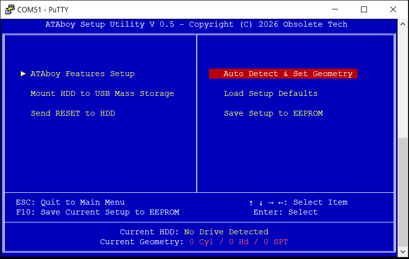

> **About this fork.** This branch adds an automation API to the ATAboy firmware
> for data recovery work: everything the setup menu does (detect, geometry,
> mount, settings) plus raw ATA commands, READ LONG, drive-internal surface
> scans, a full error log and remote firmware updates, all over the existing
> USB connection, with no serial terminal needed. The menu still works exactly
> as before.
>
> * Firmware source: [`firmware/`](firmware/) (based on v0.6f3; builds with pico-sdk 2.2.0)
> * Host tool: [`host/ataboy`](host/ataboy), a single Python file with no dependencies (Linux)
> * Protocol reference: [`docs/API.md`](docs/API.md)
> * Setup menu guide: [`docs/HELP.txt`](docs/HELP.txt)
> * Hardware: [`hardware/pcb/`](hardware/pcb/) (KiCad) and [`hardware/case/`](hardware/case/) (FreeCAD + STL)
> * Tests and tools: [`tests/`](tests/), [`tools/`](tools/) (hardware regression, hands-free flashing from WSL)
>
> Stock firmware binaries and older source releases are in the
> [upstream repository](https://github.com/redruM0381/ATAboy).
>
> ```
> ataboy detect --mount                 # probe, IDENTIFY, pick geometry, mount
> ataboy status                         # drive, geometry, config, stats, last error
> ataboy config read_timeout_ms=15000   # let a failing drive finish its own retries
> ataboy verify 0 336260                # list bad sectors without moving data over USB
> smartctl -d sat -a /dev/sdX           # standard tools via SAT ATA pass-through
> ```
>
> To make `smartctl` work without `-d sat`, install the drive database entry:
> `sudo cp tools/smart_drivedb.h /etc/smart_drivedb.h`.
>
> **Acknowledgements.** Several robustness fixes in this fork are based on
> findings in Tony Atkins' [palimpsest fork](https://github.com/BarelyBooting/ATAboy):
> the malformed-command guard, strict end-of-drive handling, partial reads,
> the per-command time budget, CHS self-reset detection, soft-reset
> hardening, the power-up reset fix, the fault handler, settings checks,
> per-sector hashes, unique USB serials and the request-id/boot-id ideas.
> They were reimplemented here, not copied; any bugs are ours.
>
> Changes for recovery use: the read timeout is adjustable and persistent (stock
> resets the drive after 1 s, mid-retry), real ATA errors reach the host instead
> of "medium not present", failed sectors can be read through the error, and the
> IDE bus is locked between the menu and USB cores.

-----------------------------------------------------------------------------------

If you don't want to build your own, the hardware can be purchased here:  https://obsoletetech.us/products/ataboy-an-open-source-legacy-ide-usb-bridge


-----------------------------------------------------------------------------------


ATAboy is designed for retro computing enthusiasts, data recovery experts, and archivists.  Read and write the oldest of IDE hard drives, without the need for an "in-between" vintage computer!

ATAboy is a user-friendly bridge that allows classic IDE (PATA) hard drives to be connected to a modern computer over USB as a standard USB Mass Storage device.  While cheap, modern adapters usually only work with newer "LBA" type drives, ATAboy works all the way back to the earliest CHS only, PIO Mode 0, ATA disks.  (It will also work with newer LBA type IDE disks, but that's not really what it's designed for.)  ATAboy features an "Award BIOS inspired" user friendly UI for drive configuration and setup.

---

When connected:

* The IDE drive appears to your computer like a normal USB Mass Storage Device
* No special drivers are required (Windows, Linux, macOS supported)
* The device translates USB Mass Storage commands into IDE read/write operations

---

## Hardware Requirements

To get started, you will also need:

* Any 40‑pin IDE (PATA) hard drive. It may be jumpered master, slave, or cable select.
* An external PSU to power the drive.
* A USB-C cable to connect ATAboy to the host computer.
* Any standard ANSI compatible serial terminal emulator (e.g. PuTTY, Tera Term, minicom, screen, etc.)

---

## Basic drive mount using ATABoy

1. Connect the IDE ribbon cable to the drive and ATAboy (Note Pin 1 orientation, usually marked by a stripe on the cable)
2. Connect ATAboy to your computer via USB
3. Power the drive using external supply
4. Connect to serial console with terminal of choice ([PuTTY](https://www.chiark.greenend.org.uk/~sgtatham/putty/latest.html) shown).  9600 8N1, no flow control.  You should see an Award BIOS "inspired" text-based UI appear in the terminal.
5. Enter the "Auto Detect & Set Geometry" menu
6. Choose default, or enter geometry manually if needed
7. Choose "Mount HDD to USB Mass Storage"
8. That's it!  You can now read the drive from your modern OS!


---



You can save the current ATAboy settings, geometry, etc to EEPROM, which will be restored the next time the device is booted.  (This allows auto-mounting also.)

IMPORTANT!  If you are working with valuable or irreplaceable data, ensure write protection is enabled before mounting.  It is enabled by default for safety.  You do NOT want the host OS to touch or bless the disk!
Windows VDS/RPC services can often crash if it is unable to write to a drive with damaged/legacy MBR and/or partition tables.
This can result in various Windows errors, unable to mount the drive, etc.  However, raw data can usually still be accessed via dd, or other raw disk backup software.
Regardless, it is STRONGLY recommended the entire drive be dumped to an image file BEFORE disabling write protection, then mounting the drive in Explorer.

---

## Safe Removal

Always use your operating system’s **Safely Remove / Eject** feature before:

* Unplugging the USB cable
* Powering off the IDE drive

This helps prevent:

* File system corruption
* Incomplete writes
* OS-side errors

---

## Known Limitations

ATAboy is a hobbyist and experimental project. You should be aware that:

* Performance is significantly slower than modern USB to IDE bridges.  We're working over USB 1.1 for now.  This can cause long mount times, especially in Windows if the disk has file system weirdness.
* Many legacy disks use unusual geometry, and may require experimentation.
* Not all OS disk utilities behave the same way

  
# PLEASE NOTE!
Some of the firmware code was written with AI assistance.  It has been tested with dozens of drives, and does function well with most.  But may be buggy, slow, or unresponsive with certain drives. Please let us know if you find a drive that does or doesn't work right. We'll build a compatibilty list soon.
# Use at your own risk!

* Firmware written in VS Code with Raspberry Pi Pico Extension
* PCB designed in Kicad
* Case designed in Freecad

---

ATAboy is meant to be hacked, learned from, and improved.
Have fun, and thank you for trying ATAboy!


# Licensing

"ATAboy" is a trademark of JJ Dasher.
The open source licenses do not grant rights to use these trademarks.

## Firmware
Licensed under GNU GPLv3.
See [LICENSE](LICENSE).

## Hardware
Licensed under CERN-OHL-W v2.
See [hardware/pcb/LICENSE](hardware/pcb/LICENSE).
